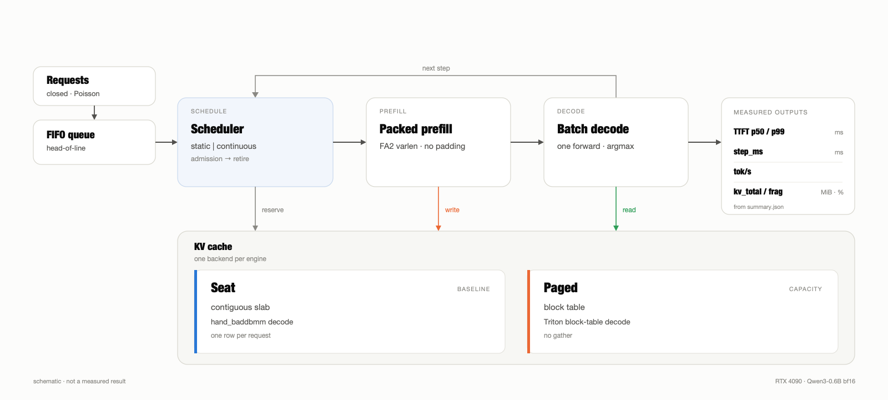
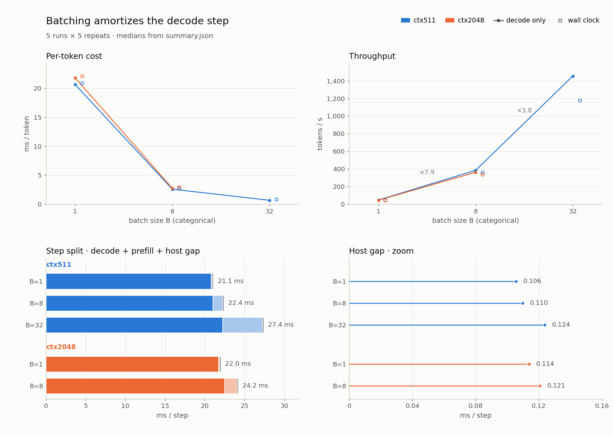
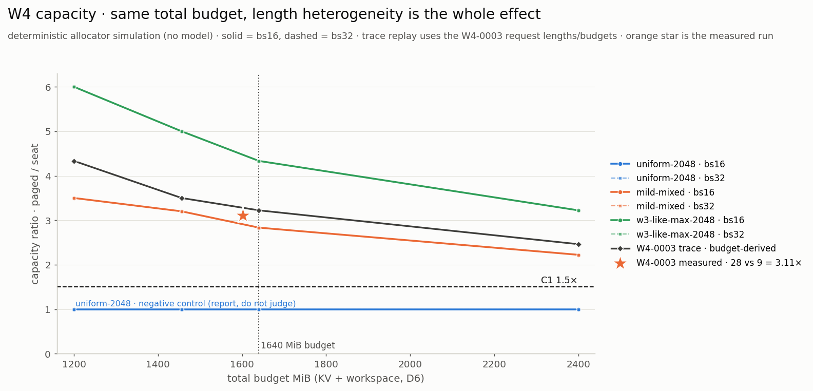
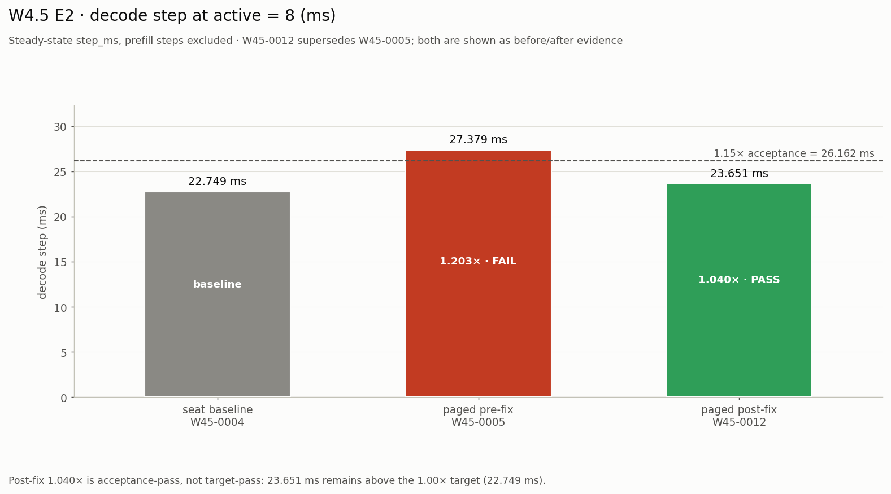
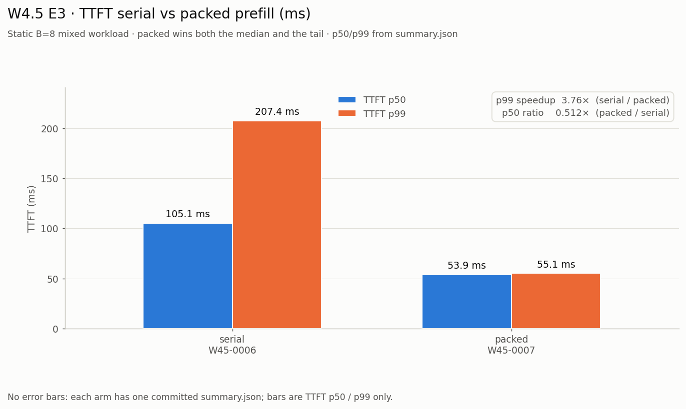
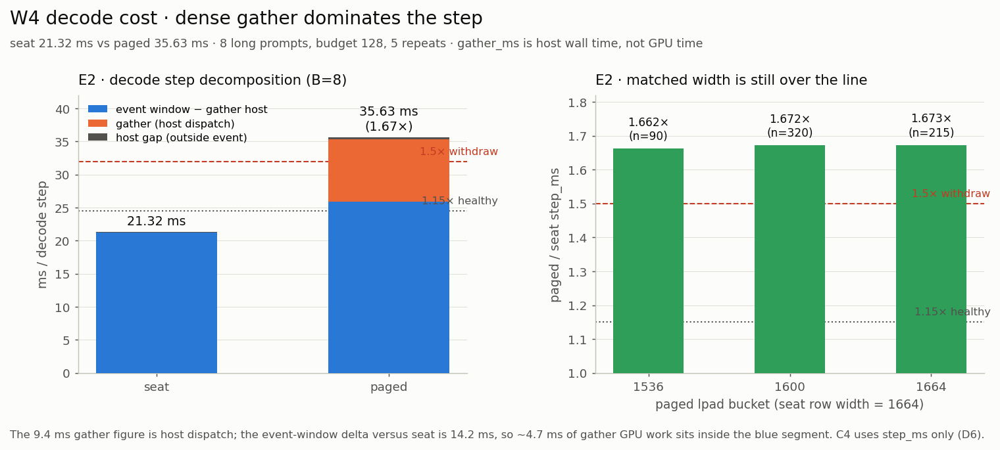

# 单卡 LLM Serving：机制收益边界实测

在单张 RTX 4090 上实现一个可运行的 serving 引擎，用同一套调度器测连续批处理、分页 KV、packed prefill 与 block-table decode 的收益边界。载体是 `Qwen/Qwen3-0.6B`；每个数字都来自 `results/` 里一次干净树上的 run，绑定 run id、设备与判据。

> **什么规模、什么上下文下，连续批处理 / 分页 KV / 混合注意力状态管理才回本？**


<sub>请求 → FIFO → Scheduler → packed prefill → batch decode；KV 层有 seat（连续 slab）和 paged（块表）两条后端。示意图，不是测量结果。</sub>

- 技术主计划：[ROADMAP.md](ROADMAP.md)（W0–W8 的唯一权威）
- 实验约定：[docs/experiments.md](docs/experiments.md)
- 决策记录：[docs/decisions.md](docs/decisions.md)
- 环境与设备口径：[docs/environments.md](docs/environments.md)
- 全部 run：[results/INDEX.md](results/INDEX.md)

## 实测结果（RTX 4090 · Qwen3-0.6B · bf16）

| 机制 | 对照 | 结果 | 判据 |
|---|---|---|---|
| W3 连续批 | static vs continuous，B=8 mixed | 154.94 → 311.43 tok/s（**2.01×**） | pass |
| W4 分页 KV | seat vs paged，同 1640 MiB | 9 → 28 并发（**3.111×**），internal frag 0.55% | C1–C3 pass；C4 **1.671×** 负结果，按预注册不报吞吐 |
| W4.5 路径 v2 | serial vs packed / seat vs paged | TTFT p99 **3.760×**；decode **1.040×**（接受线 <1.15，1.0 目标未达）；E4 **2.053×**（both saturated，record-only） | D7 accepted |

正确性门禁：W1 贪心 64/64（logits `max|Δ|` 2.0e-5）；W4 paged/seat 40/40 token 全等；W4.5 E0 64/64、E2 8/8 token hash 全等。

### 为什么批处理有效


<sub>W3 机制图 · B=1→8 吞吐 7.9×，B=8→32 再 3.8×；per-token 成本 21.1 → 0.86 ms（B=1→32，ctx511）。continuous vs static 的 2.01× 是另一组对照（`W3-0010/0011`）。</sub>

### 分页 KV 买到多少并发


<sub>W4 · 同 1640 MiB 总预算、同一 trace：seat 9 → paged 28 并发（3.111×），frag 0.55%。曲线为确定性 allocator 模拟，星标为 `W4-0003` 实测；uniform-2048 是负对照（≈1.0×），收益只来自长度异质性。</sub>

### 路径 v2：packed prefill + block-table decode


<sub>W4.5 E2 · 27.379 ms（1.203× fail）→ 23.651 ms（1.040× pass，接受线 <1.15）；seat 22.749 ms；1.0× 目标未达。`W45-0004/0005/0012`。</sub>


<sub>W4.5 E3 · TTFT p99 207.4 → 55.1 ms（3.760×），p50 105.1 → 53.9 ms（0.512×）；static B=8 mixed。`W45-0006/0007`。</sub>

## 范围与边界

当前版本覆盖 W0–W4.5：Qwen3-0.6B 上的连续批、分页 KV、packed prefill + block-table decode。
W5–W7 的混合注意力 / 双状态管理尚未实现；进度与判据以 [ROADMAP.md](ROADMAP.md) §12 为准。

W4.5 收口后，生产调度器只有 packed group，paged decode 只有 CUDA Triton block-table kernel；
CPU/MPS 上 paged 直接报错，seat 才是 CPU/MPS 路径。

## 快速开始

```bash
# 1. 依赖（miniconda base 已带 torch；这里补 transformers / tokenizers / pytest）
python -m pip install -r requirements-dev.txt

# 2. 快速门禁：不需要任何 HF 权重
python -m pytest -m "not slow and not hf"

# 3. 环境快照
python scripts/env_snapshot.py

# 4. runner 冒烟（写到临时目录，不污染 results/）
python -m bench.run \
  --config configs/experiments/W0/9001-runner-smoke.toml \
  --out /tmp/llm-serving-smoke --allow-dirty

# 5. 生成 / 校验实验索引
python scripts/exp_index.py
python scripts/exp_index.py --check
```

正式测量请在干净 git 树上跑；官方数字以 `measure-cuda`（4090）为准，本机 M1 只做正确性与冒烟。口径见 [docs/environments.md](docs/environments.md)。

## 负结果与边界

<details>
<summary><b>W4 C4：分页 decode 的 gather 代价 1.671×（点击展开）</b></summary>


<sub>W4 C4 · 同并发 B=8 decode step 21.32 → 35.63 ms（1.671×）；按预注册不报吞吐。`W4-0004/0005`。</sub>

W4 的容量结论（3.111×）成立，但 decode 代价超过预注册的 1.5× 撤回线，所以 W4 只报容量与碎片，不报吞吐。W4.5 的 packed prefill + Triton block-table decode 正是为这条负结果做的路径级返工；返工后 decode 回到 1.040×（接受线，仍不是 1.0 目标）。

</details>

## 目录

```text
model/         手写算子：RoPE / GQA / KVcache / SwiGLU / RMSNorm / TransformerBlock
llm_utils/     过渡层：sampling + 批量 generate（S2 后由 serve/engine.py 接管）
serve/         engine / scheduler / block_manager；state_pool(W7) 待实现
bench/         run / metrics / loadgen（含 poisson_trace）/ prompts.json
configs/       实验配置（experiments/）与集中阈值（thresholds.toml）
scripts/       env_snapshot / exp_index / probe_* / make_golden / align_hf / plot_*
tests/         pytest：unit + integration + golden
results/       run 目录（W*/NNNN-slug/）+ 自动生成的 INDEX.md
figures/       报告图与架构示意图
docs/          实验约定 / 决策 / 环境 / 载体 / 混合注意力
reports/       最终报告与判据矩阵
```

## License

MIT，见 [LICENSE](LICENSE)。仓库不包含模型权重；Qwen3-0.6B 的使用遵循上游许可证。
