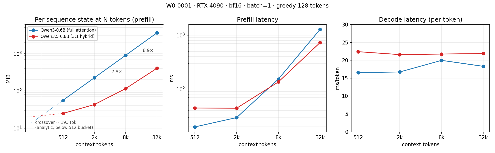

# 载体（carrier）

> 状态：**实测完成（2026-10-22，`W0-0001`，`device_class = measure-cuda`）**。
> §2 是解析式估算（预测），§3 是实测；数字以
> `results/W0/0001-carrier-probe/summary.json` 为准，本文件只做整理与判定。

## 1. 模型

| 角色 | 模型 | revision | dtype | 参数量 | 备注 |
|---|---|---|---|---|---|
| A 骨架 | `Qwen/Qwen3-0.6B` | `c1899de289a04d12100db370d81485cdf75e47ca` | bf16 | ~0.6B | 纯全注意力，W1–W4 骨架 |
| B 目标 | `Qwen/Qwen3.5-0.8B` | `2fc06364715b967f1860aea9cf38778875588b17` | bf16 | ~0.8B | 3:1 混合，W5–W7 |
| 回退 | `TinyLlama-1.1B-Chat` | 本机缓存 | fp16/bf16 | 1.1B | 仅当 A/B 卡住 |

## 2. 解析式估算（预测）

> 由 `scripts/probe_checkpoint.py --offline --write` 从 pin 住的 `config.json` 算出，
> 机器可读版本见 [carrier_estimates.json](carrier_estimates.json)。**这是预测，不是测量**；
> 实测见 §3。

```text
纯注意力每 token KV = 2 × n_kv_head × head_dim × dtype_bytes × n_full_layers
混合架构每 token   = 同上（n_full_layers 只有 1/4）
                   + 常数：n_linear_layers × n_v_head × key_head_dim × value_head_dim × state_bytes
                   + 短卷积窗口（kernel × (2·d_k + d_v)，可忽略但记一笔）
```

| 模型 | 层型 | 全注意力层 | KV / token | 线性状态 / 序列 | 常数项 / 序列 | 512 | 2k | 8k | 32k |
|---|---|---|---|---|---|---|---|---|---|
| `Qwen/Qwen3-0.6B` | `F`×28 | 28 | 112 KiB | 0 | 0 | 56 MiB | 224 MiB | 896 MiB | 3.50 GiB |
| `Qwen/Qwen3.5-0.8B` | `LLLF`×6 | 6 | 12 KiB | 18 MiB | 18.84 MiB | 24.84 MiB | 42.84 MiB | 114.84 MiB | 402.84 MiB |

**交叉点 ≈ 193 token**（`18.84 MiB / (112 − 12) KiB`），渐近 KV 比 **9.33×**。

> **更正**：ROADMAP §3.1 原写的「交叉点约 1.5k」比的是「混合的线性状态 vs 混合自己的 KV」
> （19 MB / 12 KB ≈ 1.5k），比较对象错了。要和**纯注意力**的 KV 比，差值约 100 KiB/token，
> 交叉点在 200 token 量级。已按此修 ROADMAP。

**实测校验（`W0-0001`，prefill 口径）**：解析式**完全命中**——0.6B **112.0 KiB/token**、
0.8B **12.0 KiB/token**、线性状态 **18.0 MiB**、短卷积 **0.84 MiB**，四个上下文全部吻合。

> **口径更正**：`metrics.jsonl` 的 `cache_mb` 是 **decode 结束后**的状态，比 prefill 多
> `(out_tokens−1)` 个 token 的 KV。0.8B 恒为 `127 × 12 KiB = 1.49 MiB`（此前误记为“1.5 MiB
> 未解释固定开销”），0.6B 因早停是 0–127 个不等。所以 P1/P2 必须用 `cache_prefill_mb`
> （prefill 结束时、恰好 N 个 token 的状态）；拿 final cache 除以 prompt 长度会把每 token
> 成本高估 `127/N`（512 时 +25%）。

### 2.1 口径警告：别拿「进程峰值」比

权重本身 ~1.14 GiB（0.6B）/ ~1.44 GiB（0.8B，text-only）；若直接比 `peak_memory_allocated`，
0.8B 在**任何**上下文都比 0.6B 大，KV 的差异被权重淹没。W0 必须把状态拆成
**权重 / KV / 线性状态 / 激活**，P1、P2 用「每序列状态（`cache_prefill_mb`）」判定，
总量只作辅助列。这条决定了 `bench/engines/hf.py` 要能从 `past_key_values` 里数字节。

## 3. 实测（`W0-0001`，4090，bf16，batch=1，greedy 128 token，warmup=3 / repeats=5）

`weights_mb` 与 context 无关：**0.6B = 1136.9 MiB，0.8B = 1435.1 MiB**（0.8B 只加载 text decoder，
视觉塔与 MTP 头不进显存）。P1/P2 只看 **`cache_prefill_mb`**（恰好 N 个 token 的状态：
KV + 线性状态 + 卷积窗口），`peak_mem_mb` / `mem_delta_mb` 作辅助，不参与判定。

| context | 0.6B cache (KV) | 0.8B cache (KV+state) | cache 比 0.6B/0.8B | 0.6B prefill / tpot | 0.8B prefill / tpot |
|---|---|---|---|---|---|
| 512 | 56.0 MiB | 24.8 MiB（KV 6.0 + state 18.0 + conv 0.84） | **2.25×** | 19.8 ms / 16.55 ms | 44.5 ms / 22.41 ms |
| 2k | 224.0 MiB | 42.8 MiB（KV 24.0 + 18.0 + 0.84） | **5.23×** | 29.5 ms / 16.73 ms | 44.1 ms / 21.59 ms |
| 8k | 896.0 MiB | 114.8 MiB（KV 96.0 + 18.0 + 0.84） | **7.80×** | 152.9 ms / 19.97 ms | 135.4 ms / 21.74 ms |
| 32k | 3584.0 MiB | 402.8 MiB（KV 384.0 + 18.0 + 0.84） | **8.90×** | 1282.5 ms / 18.31 ms | 729.5 ms / 21.89 ms |

> 表里是 `cache_prefill_mb`。同名 run 的 `cache_mb`（decode 结束后）为 56.2 / 237.9 / 896.1 / 3597.9 MiB
> 与 26.3 / 44.3 / 116.3 / 404.3 MiB——差值是生成的 token，不是架构开销。

辅助列（进程口径，含权重与激活，**不用于判定**）：

| context | 0.6B peak / driver | 0.8B peak / driver |
|---|---|---|
| 512 | 1216 / 1746 MiB | 1525 / 2054 MiB |
| 2k | 1422 / 2042 MiB | 1643 / 2178 MiB |
| 8k | 2253 / 3380 MiB | 2115 / 2722 MiB |
| 32k | 5578 / 8864 MiB | 4002 / 4772 MiB |

> 进程峰值 32k 只差 1.39×（5578 / 4002），因为 1.14 / 1.44 GiB 权重是固定成本；
> 差值基本等于 cache 差（3.11 GiB）。**报告引用比例时必须写清口径**。
>
> 组内重复性：同配置 5 次重复的 TTFT CV ≤ 8.1%、TPOT CV ≤ 6.8%，cache 字节完全一致。
> `summary.json.warnings` 里的 `ttft_ms CV=1.41` 是把 4 个上下文和 2 个模型**混在一起**算的
> 聚合口径 artifact，不是噪声——分组 CV 见上。W2 把 CV 改成按配置分组。

### 3.1 交叉图



复现：`python scripts/plot_w0_crossover.py`（读 `results/W0/0001-carrier-probe/summary.json`）。

### 3.2 额外发现：prefill 也有交叉点

0.8B 的 prefill 在短上下文**更慢**、长上下文**更快**（`0.8B / 0.6B` 耗时比）：

| context | 512 | 2k | 8k | 32k |
|---|---|---|---|---|
| 0.8B ÷ 0.6B prefill | 2.25× | 1.50× | 0.89× | **0.57×** |

交叉点落在 **2k–8k 之间（约 5–6k）**：32k 时 0.8B prefill 比 0.6B 快 **1.76×**（729.5 vs 1282.5 ms），
尽管它参数更多。两条曲线形状不同：0.6B 是 28 层全注意力的 O(N²)，0.8B 只有 6 层全注意力、
其余走线性注意力（本机已装 `flash-linear-attention` 0.5.2 / `causal-conv1d` 1.7.0）。

反向的代价也要记：**≤2k 时 0.8B prefill 慢 1.5–2.2×**，固定开销（短卷积 + 分块 delta rule 的
启动成本）在短序列上摊不开。这是「什么时候不划算」的一半答案。

## 4. 预测判定

| # | 预测 | 判定 | 证据 |
|---|---|---|---|
| P1 | 长上下文（≥8k）每序列显存比同量级纯注意力小 5–8× | **成立（略超上限）**：8k **7.80×**、32k **8.90×** | `W0-0001` |
| P2 | 短上下文（≤512）混合架构反而更贵 | **不成立（方向相反）**：512 上混合已小 **2.25×**；交叉点 **≈193 token**（prefill 口径），低于最小桶 | `W0-0001` |
| P3 | decode 延迟随上下文几乎不增长（线性层无 KV 读取） | **数值成立，但不可归因**：0.8B TPOT 22.41→21.89 ms（−2.3%）；0.6B 也只 +10.6%，说明 decode 被 launch/权重带宽支配 | `W0-0001` |

**P1 的口径**：按「每序列状态」成立（7.8–8.9×），按「进程峰值」只有 1.39×（权重占大头）。
D1 的判据用前者，报告必须同时给两个数。

**P2 为什么错了**：预测假设固定状态开销（18.84 MiB）会压过 512 token 的 KV 差（~50 MiB），
但实测 0.6B 的 KV 是 112 KiB/token，512 就已 56 MiB > 18.84 MiB。交叉点不在 512，
而在 **≈193 token**（`18.84 / (112 − 12) KiB`，与 prefill 实测一致）。
换句话说：**混合架构从来没有在测试过的上下文里更贵**；193 token 只出现在图左端的外推段。

**P3 为什么不能下结论**：0.8B 的 TPOT 确实平（斜率 ≈ −0.003 ms/1k token），但 0.6B 也几乎平
（16.55→18.31 ms）。batch=1 时每个 decode step 的耗时主要是 kernel launch + 读 1.1–1.4 GiB 权重
（≈1–1.5 ms 理论下限），32k 的 3.6 GiB KV 读取（≈3.6 ms）被 18 ms 的总耗时盖住。
**这条要等 batch≥8 把 KV 读放大成主导项才能验**，W2/W3 再测。

## 5. D1 决策

**接受移植**（2026-10-22，见 [decisions.md](decisions.md) D1）：P1 的 3× 判据以 7.80×（8k）/ 8.90×（32k）
满足，且比值随上下文增长；32k 时每序列省 3.11 GiB，直接换成并发数。

不投入的边界也写清楚：**上下文 < ≈193 token 时混合更贵**；**≤2k 时 prefill 慢 1.5–2.2×**。
W5–W7 的收益论证必须建立在「长上下文、多并发」这个前提上，短上下文场景不适用。
